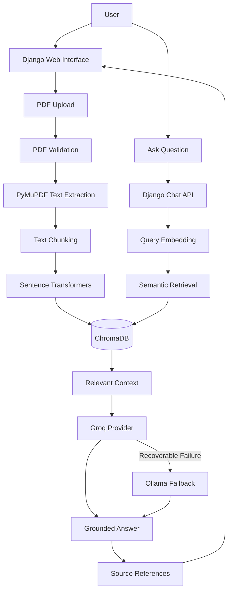

# DocuMind Lite — AI-Powered PDF Question Answering System

<p align="center">
  <strong>Django + Retrieval-Augmented Generation + Groq + Ollama</strong>
</p>

<p align="center">
  An intelligent document assistant that allows users to upload PDF files and ask questions using natural language.
</p>

---

## 1. Project Overview

**DocuMind Lite** is an AI-powered PDF question-answering application built using Django and Retrieval-Augmented Generation (RAG).

It enables users to upload technical documentation, extract document content, and ask questions about the uploaded information.

The application uses semantic search and vector embeddings to retrieve relevant document passages and generates context-aware answers using Large Language Models (LLMs).

Groq serves as the primary LLM provider, with Ollama providing a local fallback when Groq is unavailable due to recoverable operational failures.

### Key Features

- PDF document upload and validation.
- Automated PDF text extraction.
- Intelligent text chunking with page metadata.
- Local semantic embedding generation.
- Persistent vector storage using ChromaDB.
- Context-aware document retrieval.
- AI-powered question answering.
- Groq API integration.
- Automatic Ollama fallback.
- Source document and page references.
- Basic document management dashboard.

---

## 2. Technology Stack

| Category | Technologies |
|---|---|
| Backend | Python 3.11, Django 5.2 |
| Database | SQLite, Django ORM |
| PDF Processing | PyMuPDF |
| Text Chunking | Custom Python |
| Embeddings | Sentence Transformers |
| Embedding Model | BAAI/bge-small-en-v1.5 |
| Vector Database | ChromaDB |
| Primary LLM | Groq |
| Fallback LLM | Ollama |
| Local LLM | Llama 3.2 3B |
| Frontend | HTML5, CSS3, Bootstrap 5, JavaScript |
| Templates | Django Templates |
| Testing | Pytest, pytest-django |

---

## 3. System Architecture



---

## 4. RAG Workflow

DocuMind Lite follows a Retrieval-Augmented Generation pipeline.

### Document Ingestion

1. User uploads a PDF document.
2. Application validates the file.
3. PyMuPDF extracts text from each page.
4. Extracted content is cleaned and normalized.
5. Text is divided into overlapping chunks.
6. Sentence Transformers generates embeddings.
7. Embeddings and metadata are stored in ChromaDB.

### Question Answering

1. User submits a question.
2. The question is converted into an embedding.
3. ChromaDB retrieves relevant document chunks.
4. A configurable relevance threshold filters results.
5. Retrieved content is supplied as context to the LLM.
6. Groq generates an answer using the retrieved context.
7. Ollama is attempted if Groq encounters a recoverable operational failure.
8. The application returns the answer with document and page references.

If the retrieved context is insufficient, the chatbot should explicitly communicate that it cannot establish the answer from the available documents.

---

## 5. Project Structure

```text
DocuMind-Lite/
│
├── config/
│   ├── settings.py
│   ├── urls.py
│   ├── wsgi.py
│   └── asgi.py
│
├── documents/
│   ├── models.py
│   ├── views.py
│   ├── urls.py
│   └── admin.py
│
├── chatbot/
│   ├── models.py
│   ├── views.py
│   └── urls.py
│
├── core/
│   ├── views.py
│   └── urls.py
│
├── services/
│   ├── pdf_service.py
│   ├── chunking_service.py
│   ├── embedding_service.py
│   ├── vector_service.py
│   ├── rag_service.py
│   │
│   └── llm/
│       ├── base.py
│       ├── groq_provider.py
│       ├── ollama_provider.py
│       └── provider_manager.py
│
├── templates/
│   ├── base.html
│   ├── dashboard.html
│   ├── documents.html
│   └── chat.html
│
├── static/
│   ├── css/
│   └── js/
│
├── media/
│   └── uploads/
│
├── vector_store/
│
├── tests/
│
├── manage.py
├── requirements.txt
├── .env.example
├── .gitignore
├── DEVELOPMENT_LOG.md
└── README.md
```

---

## 6. Embedding and Vector Database

### Embedding Model

**BAAI/bge-small-en-v1.5**

The embedding model converts document chunks and user questions into numerical vectors.

Advantages:

- Open-source embedding model.
- Local inference.
- No external embedding API required.
- Suitable for semantic retrieval.
- Consistent vector dimensions.

### Vector Database

**ChromaDB**

ChromaDB stores:

- Document embeddings.
- Extracted text chunks.
- Document identifiers.
- Page numbers.
- Source metadata.

The vector database uses persistent storage to retain indexed documents between application restarts.

---

## 7. LLM Provider Architecture

DocuMind Lite uses a provider abstraction to support multiple LLM backends.

| Provider | Purpose | Model |
|---|---|---|
| Groq | Primary inference | Configurable Groq model |
| Ollama | Local fallback | llama3.2:3b |

### Provider Execution Strategy

```text
User Question
     |
     v
Provider Manager
     |
     v
Groq API
     |
     +---- Success ----> Return Answer
     |
     +---- Recoverable Failure
                    |
                    v
                Ollama
                    |
                    v
               Return Answer
```

Provider fallback is used for operational failures, not content-safety refusals.

---

## 8. Installation and Setup

### Prerequisites

- Python 3.11
- Git
- Ollama
- Groq API key (optional for local fallback testing)
- VS Code (recommended)

### Step 1: Clone Repository

```bash
git clone https://github.com/YOUR_USERNAME/technical-documentation-rag-chatbot.git

cd technical-documentation-rag-chatbot
```

### Step 2: Create Virtual Environment

Windows:

```powershell
py -3.11 -m venv .venv

.venv\Scripts\Activate.ps1
```

### Step 3: Install Dependencies

```bash
python -m pip install --upgrade pip

pip install -r requirements.txt
```

### Step 4: Configure Environment Variables

Create a `.env` file using `.env.example`.

Example:

```env
DJANGO_SECRET_KEY=your-secret-key
DJANGO_DEBUG=True

GROQ_API_KEY=your-groq-api-key
GROQ_MODEL=your-supported-groq-model

OLLAMA_BASE_URL=http://localhost:11434
OLLAMA_MODEL=llama3.2:3b

EMBEDDING_MODEL=BAAI/bge-small-en-v1.5

CHROMA_PERSIST_DIRECTORY=vector_store

RETRIEVAL_TOP_K=5
```

Never commit your actual `.env` file or API credentials.

### Step 5: Configure Ollama

Install Ollama and download the model:

```bash
ollama pull llama3.2:3b
```

Verify installation:

```bash
ollama list
```

### Step 6: Run Database Migrations

```bash
python manage.py makemigrations

python manage.py migrate
```

### Step 7: Start Django Server

```bash
python manage.py runserver
```

Open:

```text
http://127.0.0.1:8000/
```

---

## 9. API Endpoints

| Method | Endpoint | Description |
|---|---|---|
| GET | `/` | Dashboard |
| GET | `/documents/` | View uploaded documents |
| POST | `/documents/upload/` | Upload PDF |
| POST | `/documents/delete/<id>/` | Delete document |
| GET | `/chat/` | Chat interface |
| POST | `/api/chat/` | Ask document questions |
| GET | `/api/health/` | Application health |
| GET | `/api/documents/` | Document listing API |

API endpoints use structured JSON responses and Django CSRF protection for browser-originated POST requests.

---

## 10. Testing

Run the test suite:

```bash
pytest
```

### Testing Coverage

- PDF file validation.
- PDF text extraction.
- Empty PDF handling.
- Text chunking and overlap.
- Embedding dimensions.
- Vector insertion and retrieval.
- Document-specific vector deletion.
- Groq provider error handling.
- Ollama provider error handling.
- Automatic provider fallback.
- Insufficient-context questions.
- API request validation.
- Document ingestion and retrieval integration.

External LLM requests should be mocked in automated tests wherever possible.

---

## 11. Development Roadmap

### Day 1 — Core Backend and RAG Implementation

- Django project configuration.
- PDF upload and extraction.
- Text chunking.
- Local embedding generation.
- ChromaDB integration.
- Groq integration.
- Ollama fallback.
- RAG retrieval pipeline.
- Basic application interface.
- Core automated tests.

### Day 2 — UI and User Experience

- Improve dashboard design.
- Enhance document management.
- Develop interactive chat interface.
- Improve source citation presentation.
- Add loading indicators and error handling.
- Improve responsiveness.

### Day 3 — Testing and Finalization

- End-to-end testing.
- RAG retrieval evaluation.
- Error handling improvements.
- Performance optimization.
- Documentation completion.
- GitHub repository finalization.
- Final project demonstration.

---

## 12. Security and Reliability

- API credentials stored in environment variables.
- Server-side PDF validation.
- Secure generated filenames.
- Upload size restrictions.
- Django CSRF protection.
- No frontend exposure of API credentials.
- Persistent vector storage.
- Document-specific vector deletion.
- Explicit LLM provider error handling.
- Protection against prompt injection from retrieved document content.
- Grounded answers with source references.

---

## 13. Project Objectives and Expected Outcome

The expected outcome is a functional document intelligence application that reduces the effort required to search and understand lengthy technical documents.

Users should be able to upload PDFs, ask questions in natural language, retrieve relevant information, and receive answers supported by document-level and page-level references.

---

## 14. Current Project Status

**Development Phase:** Day 1 — Core Implementation

**Project Status:** In Progress

Implementation milestones and test results will be updated as features are completed and verified.

---

## 15. Future Enhancements

- Multiple document collections.
- Conversation history.
- Document-specific chat.
- Improved hybrid retrieval.
- Reranking models.
- Support for DOCX and TXT.
- User authentication.
- Streaming AI responses.
- Advanced retrieval evaluation.
- Deployment with production-ready configuration.

---

## 16. License

This project is intended for academic and educational purposes.

A license can be added to the repository when the project licensing decision is finalized.

---

<p align="center">
  <strong>DocuMind Lite</strong><br>
  Intelligent Document Understanding with Retrieval-Augmented Generation
</p>
